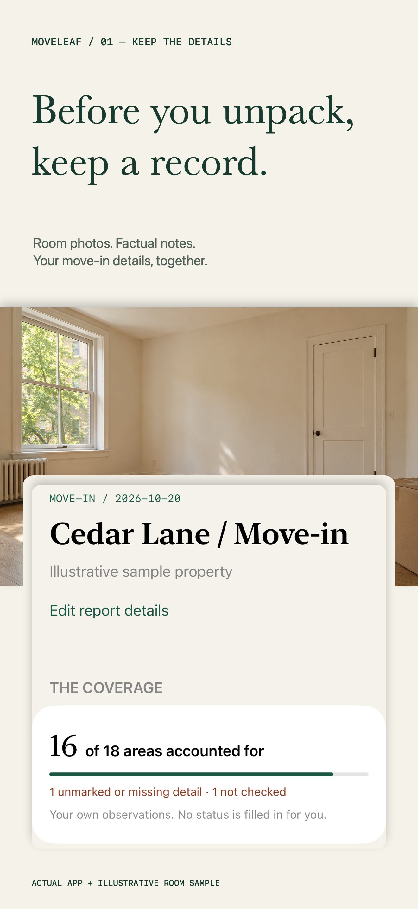
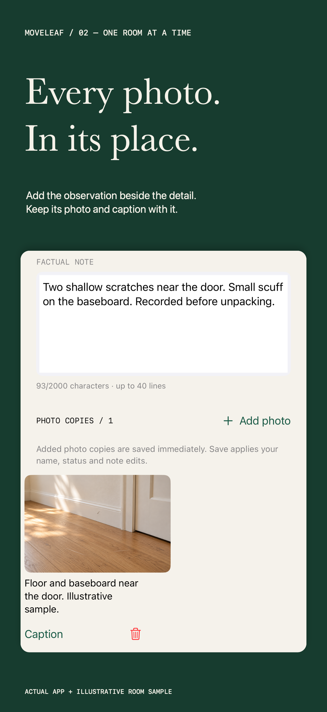
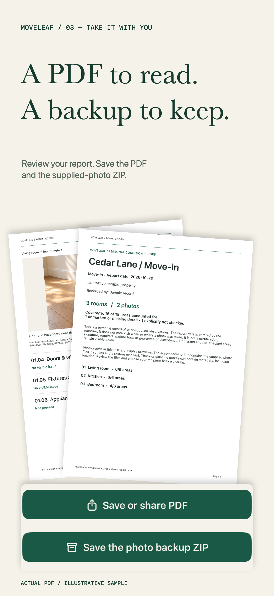

# Moveleaf: Move In Report

**Before you unpack, keep the details.** A personal room-condition record for iPhone and iPad: each supplied photo and factual note belongs with a room area, and unfinished observations remain visible in the PDF.

Production status: in development. App Store review has not been submitted. TestFlight is skipped at the publisher's request; production checks remain required.

[Product and support](https://sepidehdalir.github.io/moveleaf/) · [Privacy](https://sepidehdalir.github.io/moveleaf/privacy.html) · [Support guide](https://sepidehdalir.github.io/moveleaf/support.html)

| Keep the details | One room at a time | Take it with you |
| --- | --- | --- |
|  |  |  |

[Dedicated iPad campaign](assets/campaign/iPad/01-moveleaf.png)

## A focused workflow

Start a move-in, move-out or other personal report. Add rooms and work through six editable areas per room. Choose a status, write factual notes and select still photos from Files or the system Photos picker. Review the PDF and save both the PDF and original-photo ZIP backup. Restoring a valid backup creates a new report; it never replaces an existing report.

Unmarked, missing-detail and explicitly not-checked areas stay visible. An entered report date is user supplied. Moveleaf does not certify condition, authenticate photo capture times, guarantee a deposit outcome or replace required forms, signatures or professional assessments.

## Product and engineering

- Native SwiftUI interface with a room index and detail workspace on wider iPad layouts; Universal iPhone/iPad deployment target15.0, built using Xcode26.5. Available execution runtimes start at iOS17; iOS15 runtime execution is not claimed.
- Bounded local storage with atomic report adoption, staged imports, recoverable whole-report Trash, cancellation and explicit errors that preserve existing files.
- ImageIO inspection, orientation-correct display previews and byte-preserving supplied photo copies with SHA256 verification.
- A paginated CoreGraphics/CoreText PDF that includes captions, coverage gaps, source filenames and photo hashes. A standard uncompressed ZIP contains the report data, supplied photo copies and PDF.
- Strict ZIP restore checks for paths, structure, CRC, schema, resource bounds and photo hashes; adoption uses a new report UUID.
- StoreKit2 product loading, Apple-localized price, verified entitlement, purchase, restore and revocation handling. Free includes one active report, up to three rooms and full PDF/ZIP export. Optional one-time Lifetime Pro expands room, report and template capacity.
- No account, developer backend, tracking or analytics upload. Reports stay on the device; Apple-managed device backups may include them. Sharing uses the destination selected by the user.

## Verification recorded so far

Seven core tests cover persistence, photo limits, export/restore integrity, cancellation and interrupted staging. Native free create/note/export/PDF-preview/relaunch flows passed on iOS17 and26.5. Local StoreKit tests covered purchase, relaunch, restore, refund/revocation, pending and failure/cancel behavior. Final illustrative photo/caption display and native PDF/ZIP/share-sheet checks passed on iPhone26.5 and iPad17. The native iPhone ZIP was independently checked for CRC, exact photo bytes and exact embedded PDF; all five PDF pages were visually inspected.

Apple validation and upload of the final signed1.0(1) archive passed. The processed build is attached to the version; five medium iPhone, five large iPhone and five dedicated iPad campaign frames are accepted. Lifetime Pro is Ready for Review in an unsubmitted draft. Physical photo-picker adoption, actual saved Files backup roundtrip, genuine Apple Sandbox purchase/restore, App Review submission remain pending. Moveleaf’s Data Not Collected label and live privacy policy were published with the publisher’s explicit approval on October20,2026. Final UI automation recorded a share-cell timeout on iPhone and a test-runner bootstrap failure on iPad; direct final-build checks confirmed their layouts and native PDF/ZIP integrity without claiming those automated tests passed. Simulator Photos picker loading failures are recorded rather than presented as successful imports.

Campaign imagery and property details are illustrative. The campaign uses authentic application UI and PDFs created by Moveleaf. This public repository contains the professional case study, marketing assets and support website; commercial application source is backed up separately in a private repository.

## Built by

**Sepideh Javanbakht Dalir** · [Arvinify](https://www.arvinify.com) · [hello@arvinify.com](mailto:hello@arvinify.com)
